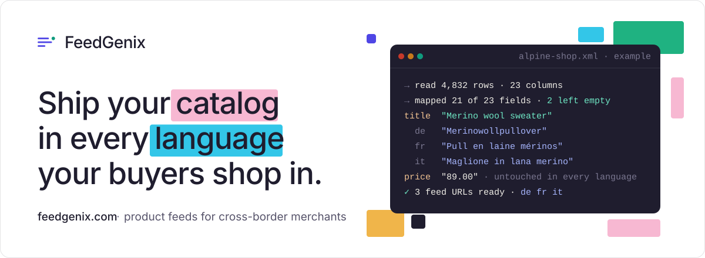

<p align="center">
  <a href="https://feedgenix.com"></a>
</p>

<h1 align="center">FeedGenix</h1>

<p align="center"><b>AI feed intelligence for e-commerce catalogues.</b></p>

<p align="center">
  
  
  
  
  
  
  
</p>

Connect a product feed, review the AI field mapping,
translate it into the languages you choose and publish a feed URL your channels can pull. Prices,
stock and barcodes pass through untouched.

> Status: private beta on staging. Done: identity, tenancy, entitlements, ingest, the AI gateway and
> credits, the AI mapping (M1–M3). In progress (M4): the catalogue, the translation plan and engine,
> and their pages. See `docs/adr/` for the decisions and `docs/porting-map.md` for the build order.

## Stack
- **Backend:** Laravel 13, PHP 8.3+, PostgreSQL 18 (+ pgvector), Redis on servers, Sanctum.
- **Frontend (`frontend/`):** React 19, React Router 8 (framework mode, SPA + pre-rendered marketing
  pages), Vite 8, Tailwind 4, TanStack Query, openapi-fetch.
- **Quality gates:** Pint, Larastan level 8, Rector, Pest (arch + unit + feature, on PostgreSQL),
  TypeScript strict, oxlint, Prettier, Vitest + MSW, Playwright, gitleaks.

## Getting started
Requirements: PHP 8.3+ with `pdo_pgsql`, `intl`, `zip`; Composer 2; Node 24; PostgreSQL 18.

```bash
# database (as a PostgreSQL superuser; the app role must NOT be superuser or BYPASSRLS)
psql -U postgres -c "CREATE ROLE feedgenix LOGIN PASSWORD '<choose one>' CREATEDB NOSUPERUSER NOBYPASSRLS;"
psql -U postgres -c "CREATE DATABASE feedgenix OWNER feedgenix;" -c "CREATE DATABASE feedgenix_test OWNER feedgenix;" -c "CREATE DATABASE feedgenix_e2e OWNER feedgenix;"

# backend
composer install
cp .env.example .env            # set DB_PASSWORD
php artisan key:generate
php artisan migrate
php artisan serve               # http://127.0.0.1:8000
php artisan queue:work          # imports, catalogue reads and translations run on the queue
php artisan schedule:work       # ops:reconcile every minute: leases, holds, waiting files

# frontend (proxies /api to :8000, same origin)
cd frontend
npm ci
npm run dev                     # http://localhost:5173
```

## Checks
```bash
composer check                  # Pint · Larastan · Rector · Pest
cd frontend && npm run check    # tsc · oxlint · Prettier · Vitest · build
cd frontend && npm run e2e      # Playwright against the production build (own database: feedgenix_e2e)
```

After changing an API endpoint: `composer api:export && (cd frontend && npm run api:types)`.

<p align="center">
  <a href="https://feedgenix.com"><picture>
    <source media="(prefers-color-scheme: dark)" srcset=".github/readme/feedgenix-mark-inverse.svg">
    
  </picture></a><br>
  <sub>feedgenix.com · product feeds for cross-border merchants</sub>
</p>
